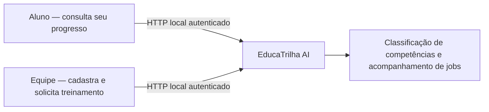
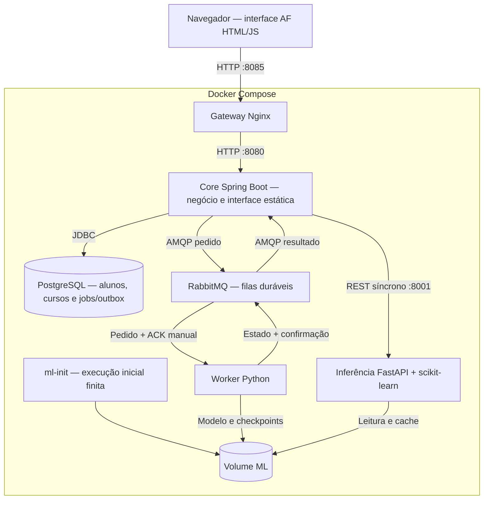
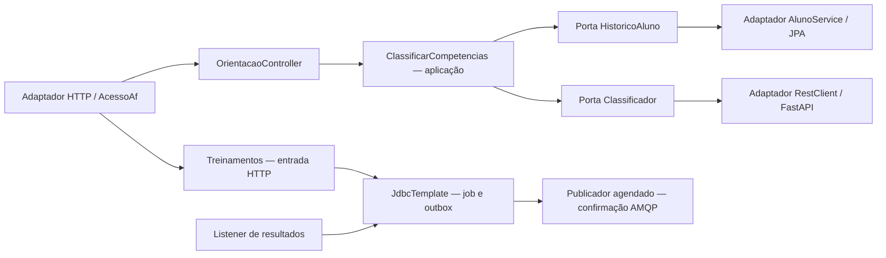
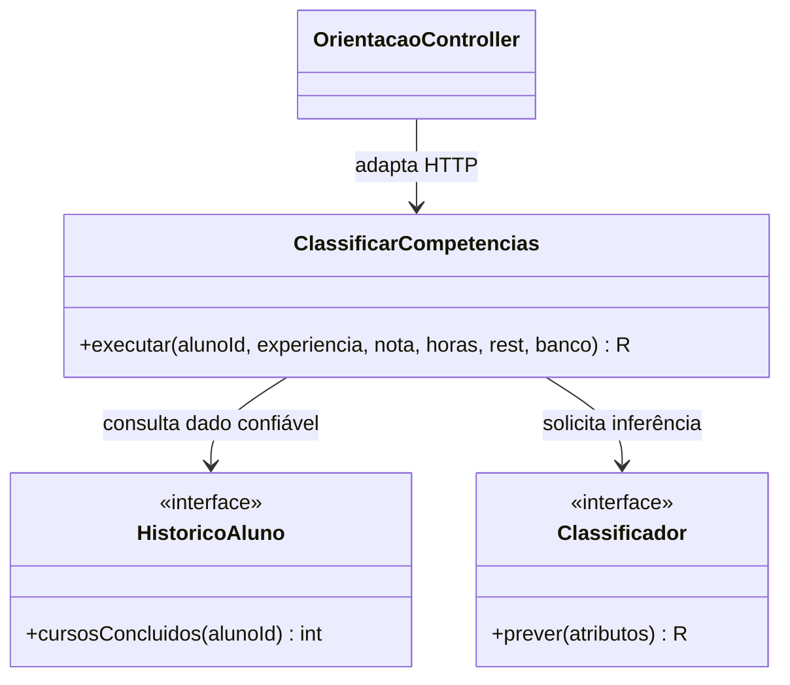
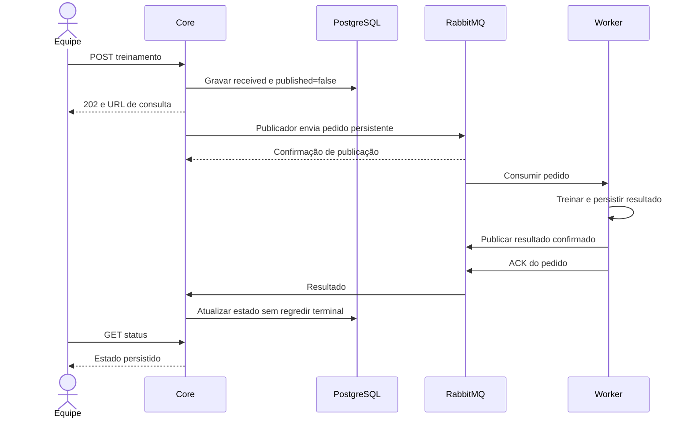

# EducaTrilha AI — evolução da Educação Continuada Gamificada

**AF v3 — entrega individual de RF02 e RF05 em revisão.** Spring Boot e FastAPI estão implementados. RF03/RF04, Spring AI e o modelo generativo no Docker ainda precisam ser integrados por Camargo. Este estado não é apresentado como AF completa.

| Integrante | RA | Responsabilidade AF |
|---|---|---|
| Gustavo Gutierres Champam | 223645 | Tech lead; RF02 classificação e RF05 treinamento/status |
| Gustavo Oliveira Camargo | 236024 | RF03 recomendação RAG; RF04 agente autorizado; revisão técnica de Champam |

O problema é orientar a evolução dos alunos a partir de competências e progresso, preservando as regras da AC1. RF01/cadastros, promoção por 12 cursos e recompensas são herdados e não contam como requisitos novos.

## Executar RF02 e RF05

Com Docker e Compose disponíveis, na raiz:

```sh
docker compose up --build
```

Abra [a aplicação](http://localhost:8085). Usuário `champam`, senha de demonstração `af-demo-champam-2026`. Os usuários `aluno1` e `aluno2` usam `af-demo-aluno1-2026` e `af-demo-aluno2-2026` e só consultam o respectivo aluno. As contas são de laboratório, não um sistema de identidade de produção.

O primeiro build baixa imagens e dependências. `ml-init` treina a base sintética uma vez; o modelo é persistido em volume. Cadastro, classificação e treinamento não exigem chave paga nem execução de processos fora do Docker. O gateway publica somente `127.0.0.1:8085`; banco, broker e ML são internos.

O frontend HTML/JavaScript AF é servido pelo Core através do gateway. O frontend Vue original permanece na [AC1 histórica](README_AC1.md), com `compose.ac1.yaml`. Recomendações, agente autorizado e RAGAS ainda retornam indisponibilidade nesta composição; os nomes `orientacao-af` e `evaluation-af` reservam os pontos de integração, não representam serviços já implantados.

## Requisitos e código

| Requisito | Entrada | Implementação |
|---|---|---|
| RF02 | POST `/api/af/alunos/{id}/classificacao` | [Caso de uso](src/main/java/br/com/educacao/gamificada/af/application/ClassificarCompetencias.java), [adaptador HTTP](src/main/java/br/com/educacao/gamificada/af/OrientacaoController.java), [FastAPI](ml/app.py) |
| RF05 | POST `/api/af/treinamentos`; GET `/api/af/treinamentos/{id}` | [Outbox e estados](src/main/java/br/com/educacao/gamificada/af/Treinamentos.java), [worker](ml/worker.py), [treinamento](ml/training.py) |
| RF03/RF04 | Recomendação e agente | Camargo: implementar Spring AI, recuperação e geração local, autorização, testes e integrar ao Compose |

## C4 — nível 1: contexto



Não há provedor externo de IA no fluxo RF02/RF05. A geração local planejada para RF03/RF04 deve permanecer sem API paga.

## C4 — nível 2: containers implantados



Arquitetura híbrida: Core modular e serviços separados de inferência/treinamento. Banco e filas são infraestrutura; não são apresentados como microsserviços de negócio. O gateway roteia para o Core e centraliza a entrada; autorização permanece no Core. Serviços Spring AI e avaliação ainda não estão neste diagrama de implantação, pois não foram integrados.

## C4 — nível 3: componentes do Core



O caso de uso de classificação depende de interfaces Java, sem Spring ou rede. A composição dos adaptadores ocorre no controller. O módulo ranking herdado também usa portas/adaptadores. RF05 permanece um módulo com controller, persistência e mensageria agrupados: não se afirma que todos os arquivos sejam hexagonais.

## C4 — nível 4: código de classificação



## Comunicações síncrona e assíncrona

Classificação usa HTTP síncrono: o aluno precisa da resposta imediatamente. O Core inclui os cursos consultados no banco e limita a espera pelo ML a 2 segundos. Uma falha devolve 503, sem inventar um perfil, e não impede o cadastro.

Treinamento usa AMQP assíncrono: pode demorar e deve ser aceito com ML/broker indisponíveis. O Core responde 202 após inserir o job. O publicador envia após recuperação do broker; o worker publica `running` e `completed`/`failed`. A consulta de status usa HTTP.



## Drivers arquiteturais e decisões

| ASR | Decisão | Validação |
|---|---|---|
| RNF01: 95% das classificações em até 2s, 300 usuários | Modelo em memória, pool do Core, ML separado | 3 rajadas iniciais, 30s aquecimento, 60s de carga; resultado por commit no Actions |
| RNF02: aceitar treino com ML fora do ar | Job/outbox persistente, filas duráveis e ACK após resultado | CI para worker/ML e broker, aceita pedido e verifica conclusão após retorno |
| RNF03: acesso restrito aos dados | Autenticação no Core, autorização por aluno e serviços internos | Testes 401/403/200; consentimento RF04 ainda exige implementação completa do Camargo |

**ADR-001 — adotar Core modular com ML separado e mensageria.** Contexto: equipe de dois, regras AC1 estáveis, treinamento demorado e necessidade de consulta rápida. Decisão: preservar o Core, isolar inferência/worker e publicar jobs via outbox. Alternativas: treinar na requisição bloqueia o usuário; decompor todos os cadastros em microsserviços aumenta operação sem necessidade. Consequências: implantação e atualização de ML independentes; maior complexidade de filas, consistência eventual e recuperação. O gateway mantém uma entrada única. A decisão atende RNF04/RNF05 sem exigir decomposição completa da aplicação.

## Testes, limitações e entrega

- Java: `./mvnw verify` (Windows: `mvnw.cmd verify`). Cobertura exigida: 100% de linhas e ramos; PostgreSQL real é executado no CI.
- Python: instalar `ml/requirements.txt` e executar `python -m unittest discover -s ml -p "test_*.py" -v`.
- Docker: [workflow RF02/RF05](.github/workflows/af.yml), integração HTTP, falhas, carga e navegador real. [PR de Champam](https://github.com/Gustavo-Champam/educacao-continuada-gamificada/pull/1).
- Detalhes e limites: [entrega técnica Champam](documentacao/af/ENTREGA_CHAMPAM.md). As métricas antigas em `documentacao/af/evidencias` são históricas e não validam automaticamente esta composição.

Dados são sintéticos; autenticação é de laboratório; não há TLS, SSO nem garantia de desempenho em qualquer hardware. Modelo e metadados têm troca individual de arquivo, sem rollout transacional. A fila `ml.training.invalid` exige inspeção manual. Não há alta disponibilidade.

A AF conjunta ainda exige RF03/RF04 com Spring AI em Docker, contribuições reais e PR do Camargo, revisão de ambos e merge após aprovação. A entrega à professora é o link do GitHub e o link de vídeo de 20 minutos no YouTube **não listado**, com ambos de câmera aberta, na sequência a–i do enunciado. Roteiros de ensaio não integram os fontes.
