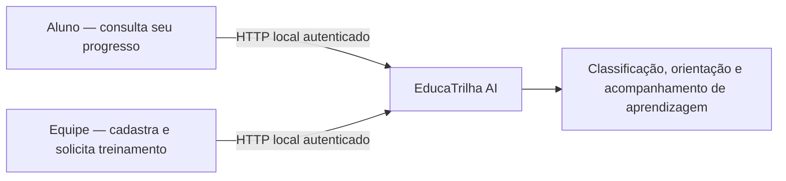
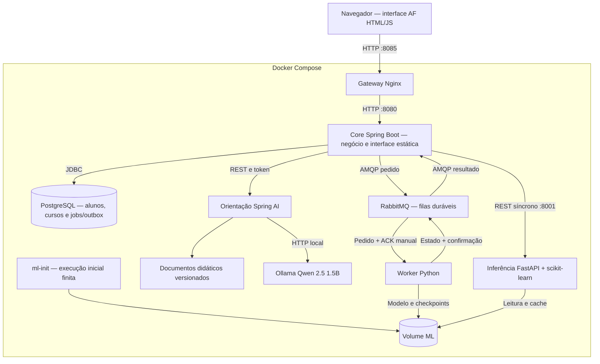
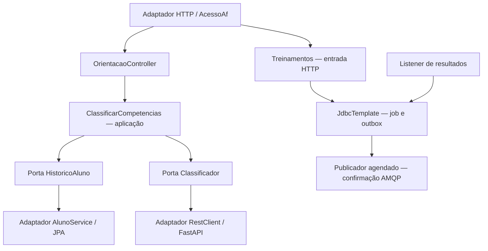
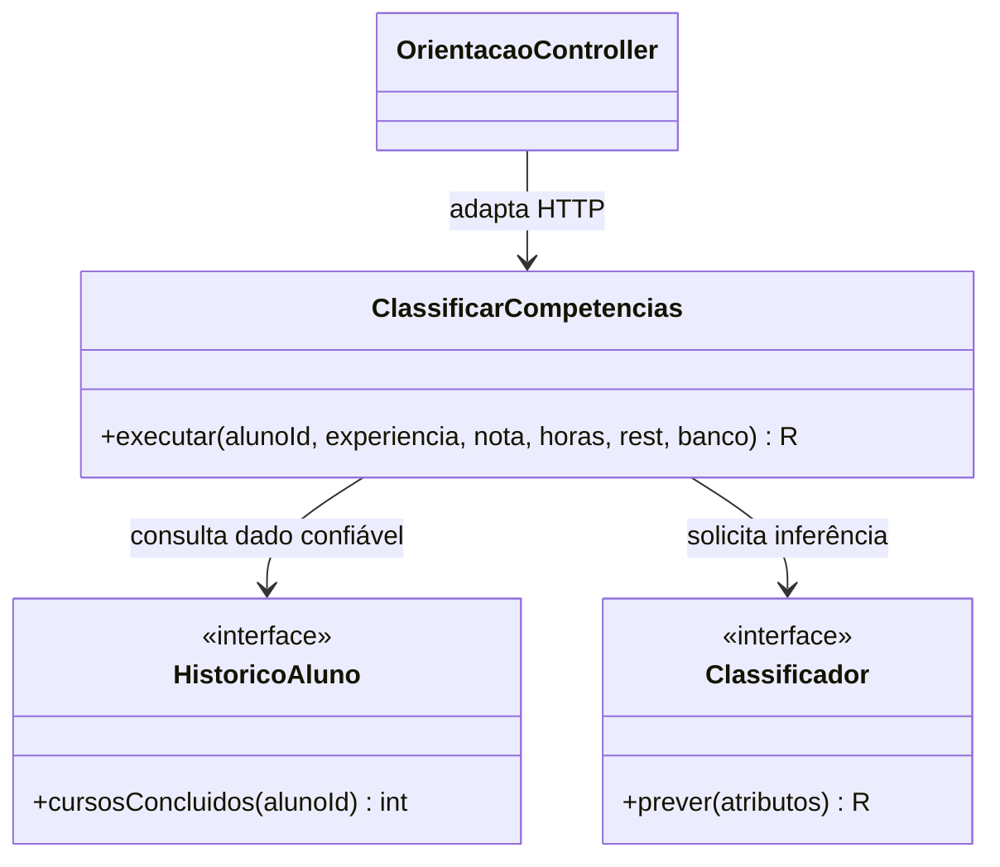
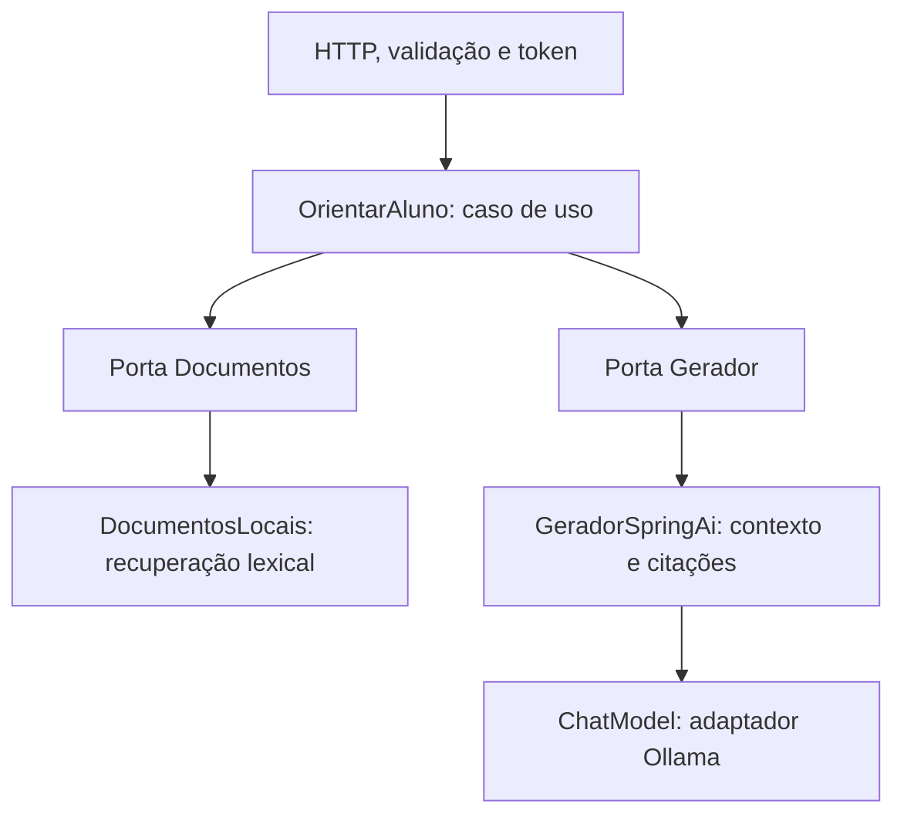
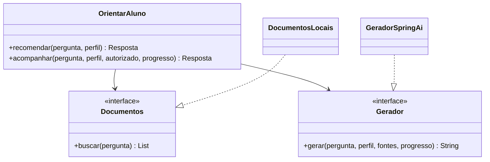
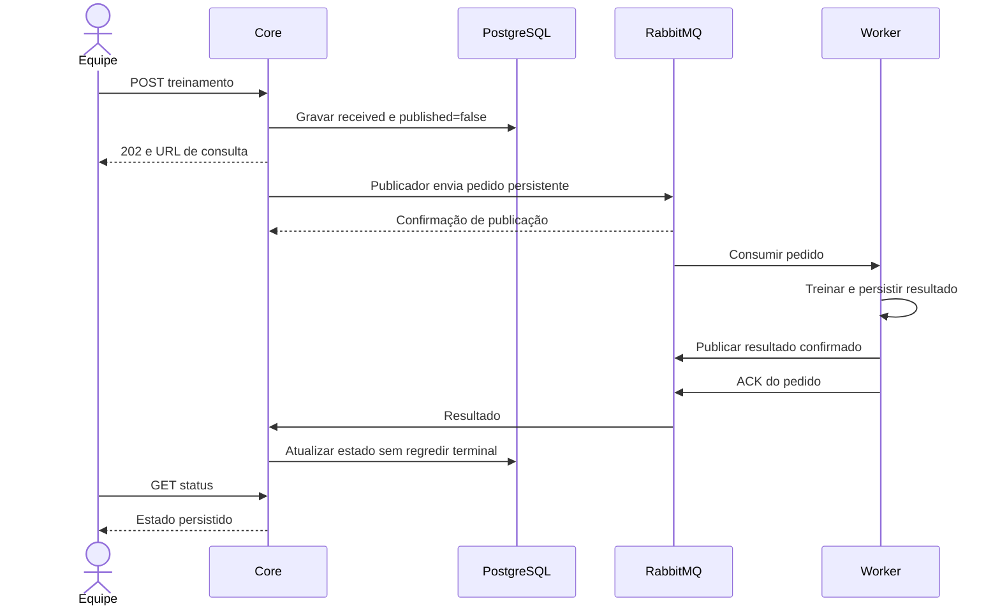

# EducaTrilha AI — evolução da Educação Continuada Gamificada

**AF v3 — RF02–RF05 implementados, entrega conjunta em revisão.** Spring Boot, FastAPI, Spring AI e Ollama integram o Compose. Veja a [entrega Camargo](documentacao/af/ENTREGA_CAMARGO.md), o [PR #2](https://github.com/Gustavo-Champam/educacao-continuada-gamificada/pull/2) e os checks por commit. Revisão humana, resolução dos alertas e apresentação ainda são necessárias.

| Integrante | RA | Responsabilidade AF |
|---|---|---|
| Gustavo Gutierres Champam | 223645 | Tech lead; RF02 classificação e RF05 treinamento/status |
| Gustavo Oliveira Camargo | 236024 | RF03 recomendação RAG; RF04 agente autorizado; revisão técnica de Champam |

O problema é orientar a evolução dos alunos a partir de competências e progresso, preservando as regras da AC1. RF01/cadastros, promoção por 12 cursos e recompensas são herdados e não contam como requisitos novos.

## Executar a AF completa

Com Docker e Compose disponíveis, na raiz:

```sh
docker compose up --build
```

Abra [a aplicação](http://localhost:8085). Usuário `champam`, senha de demonstração `af-demo-champam-2026`. Os usuários `aluno1` e `aluno2` usam `af-demo-aluno1-2026` e `af-demo-aluno2-2026` e só consultam o respectivo aluno. As contas são de laboratório, não um sistema de identidade de produção.

A conta `camargo` usa a mesma senha de laboratório da equipe. O primeiro build baixa imagens, dependências e o modelo `qwen2.5:1.5b`. Aguarde `ollama-init` terminar com código zero antes de usar recomendações; acompanhe com `docker compose logs -f ollama-init`. O download exige internet, mas a inferência usa o modelo local. `ml-init` treina a base sintética uma vez; o modelo é persistido em volume. Cadastro, classificação e treinamento não exigem chave paga nem execução de processos fora do Docker. O gateway publica somente `127.0.0.1:8085`; banco, broker e ML são internos.

O frontend HTML/JavaScript AF é servido pelo Core através do gateway. O frontend Vue original permanece na [AC1 histórica](README_AC1.md), com `compose.ac1.yaml`. Recomendações e agente usam o serviço `orientacao-af` (Spring AI) e o Ollama. RAGAS não está implantado nesta composição e foi removido da interface; seu endpoint experimental não comprova avaliação de qualidade.

## Requisitos e código

| Requisito | Entrada | Implementação |
|---|---|---|
| RF02 | POST `/api/af/alunos/{id}/classificacao` | [Caso de uso](src/main/java/br/com/educacao/gamificada/af/application/ClassificarCompetencias.java), [adaptador HTTP](src/main/java/br/com/educacao/gamificada/af/OrientacaoController.java), [FastAPI](ml/app.py) |
| RF05 | POST `/api/af/treinamentos`; GET `/api/af/treinamentos/{id}` | [Outbox e estados](src/main/java/br/com/educacao/gamificada/af/Treinamentos.java), [worker](ml/worker.py), [treinamento](ml/training.py) |
| RF03 | POST `/api/af/alunos/{id}/recomendacao` | [Serviço Spring AI](orientacao-ai/src/main/java/br/com/educacao/orientacao/), recuperação documental lexical e geração local com fontes |
| RF04 | POST `/api/af/alunos/{id}/agente` | Consentimento por solicitação, progresso confiável consultado no Core, ferramentas de leitura e orientação |

## C4 — nível 1: contexto



Não há API paga de IA. O ML classifica competências e o Ollama gera recomendações em infraestrutura local; downloads iniciais e uso de hardware continuam necessários.

## C4 — nível 2: containers implantados



Arquitetura híbrida: Core modular e serviços separados de inferência/treinamento. Banco e filas são infraestrutura; não são apresentados como microsserviços de negócio. O gateway roteia para o Core e centraliza a entrada; autorização permanece no Core. Spring AI e Ollama são independentes do Core. A avaliação RAGAS não faz parte da implantação atual.

## C4 — nível 3: componentes do Core



O caso de uso de classificação depende de interfaces Java, sem Spring ou rede. A composição dos adaptadores ocorre no controller. O módulo ranking herdado também usa portas/adaptadores. RF05 permanece um módulo com controller, persistência e mensageria agrupados: não se afirma que todos os arquivos sejam hexagonais.

## C4 — nível 4: código de classificação



## Componentes e código da orientação (C4 níveis 3 e 4)





O caso de uso não depende de Spring. O Core verifica acesso e consentimento antes de consultar o progresso. Só plano e contagem de cursos seguem para a orientação; nome e ID não são enviados ao modelo. O agente executa um fluxo controlado de consulta e orientação, sem matrícula, alteração de plano ou acompanhamento autônomo em segundo plano.

## Comunicações síncrona e assíncrona

Orientação também usa HTTP síncrono: recuperar documentos, montar o contexto e gerar uma resposta local. O cliente do Core espera até 120 segundos e o gateway até 130 segundos. Falha de modelo retorna 503; ausência de documentos relevantes retorna resposta sem geração. IDs citados precisam pertencer aos documentos recuperados. Isso valida a origem da citação, mas não garante que todo texto gerado seja factualmente correto.

Classificação usa HTTP síncrono: o aluno precisa da resposta imediatamente. O Core inclui os cursos consultados no banco e limita a espera pelo ML a 2 segundos. Uma falha devolve 503, sem inventar um perfil, e não impede o cadastro.

Treinamento usa AMQP assíncrono: pode demorar e deve ser aceito com ML/broker indisponíveis. O Core responde 202 após inserir o job. O publicador envia após recuperação do broker; o worker publica `running` e `completed`/`failed`. A consulta de status usa HTTP.



## Drivers arquiteturais e decisões

| ASR | Decisão | Validação |
|---|---|---|
| RNF01: 95% das classificações em até 2s, 300 usuários | Modelo em memória, pool do Core, ML separado | 3 rajadas iniciais, 30s aquecimento, 60s de carga; resultado por commit no Actions |
| RNF02: aceitar treino com ML fora do ar | Job/outbox persistente, filas duráveis e ACK após resultado | CI para worker/ML e broker, aceita pedido e verifica conclusão após retorno |
| RNF03: acesso restrito aos dados | Autenticação no Core, autorização por aluno e serviços internos | Testes 401/403/200; consentimento obrigatório por solicitação RF04, consulta de progresso somente após autorização |

**ADR-001 — adotar Core modular com ML separado e mensageria.** Contexto: equipe de dois, regras AC1 estáveis, treinamento demorado e necessidade de consulta rápida. Decisão: preservar o Core, isolar inferência/worker e publicar jobs via outbox. Alternativas: treinar na requisição bloqueia o usuário; decompor todos os cadastros em microsserviços aumenta operação sem necessidade. Consequências: implantação e atualização de ML independentes; maior complexidade de filas, consistência eventual e recuperação. O gateway mantém uma entrada única. A decisão atende RNF04/RNF05 sem exigir decomposição completa da aplicação.

**ADR-002 — isolar orientação e usar geração local.** Contexto: RF03/RF04 exigem orientação com documentos e autorização, sem API paga. Decisão: serviço Spring AI com portas `Documentos`/`Gerador`, recuperação lexical do corpus versionado e Ollama local. Alternativas: colocar a IA no Core aumenta acoplamento; serviço pago contraria o custo pretendido; embeddings e banco vetorial acrescentam operação desnecessária para quatro documentos. Consequências: cadastros continuam disponíveis quando o modelo falha; recuperação lexical tem limitações com sinônimos e o modelo pequeno exige revisão das respostas. A base é fictícia e não contém documentos oficiais da FACENS.

## Testes, limitações e entrega

- Java Core: `./mvnw verify` (Windows: `mvnw.cmd verify`). Gate do Core: 100% de linhas e ramos nos pacotes configurados; PostgreSQL real é executado no CI.
- Spring AI: `./mvnw -f orientacao-ai/pom.xml verify` (Windows: `mvnw.cmd -f orientacao-ai/pom.xml verify`). O módulo gera relatório JaCoCo próprio, sem alegação de cobertura de 100%.
- Python: instalar `ml/requirements.txt` e executar `python -m unittest discover -s ml -p "test_*.py" -v`.
- Docker: [workflow AF](.github/workflows/af.yml), integração HTTP, falhas, carga, navegador real e geração Ollama real via `scripts/validar-orientacao.py`. O artefato `af-integracao-real` contém os resultados por commit. [PR de Champam](https://github.com/Gustavo-Champam/educacao-continuada-gamificada/pull/1).
- Detalhes e limites: [entrega técnica Champam](documentacao/af/ENTREGA_CHAMPAM.md). As métricas antigas em `documentacao/af/evidencias` são históricas e não validam automaticamente esta composição.

Dados são sintéticos; autenticação é de laboratório; não há TLS, SSO nem garantia de desempenho em qualquer hardware. Modelo e metadados têm troca individual de arquivo, sem rollout transacional. A fila `ml.training.invalid` exige inspeção manual. Não há alta disponibilidade.

A AF conjunta ainda exige revisão humana de ambos os PRs, resolução dos alertas de checks e merge após aprovação. Conforme a divisão registrada pela equipe, entregar GitHub e vídeo de 20 minutos no YouTube **não listado**, com ambos de câmera aberta, na sequência a–i. O PDF AF v3 recebido contém a avaliação escrita de arquitetura (itens a–e); confirmar o enunciado complementar que determina os detalhes do vídeo. Roteiros de ensaio não integram os fontes.
