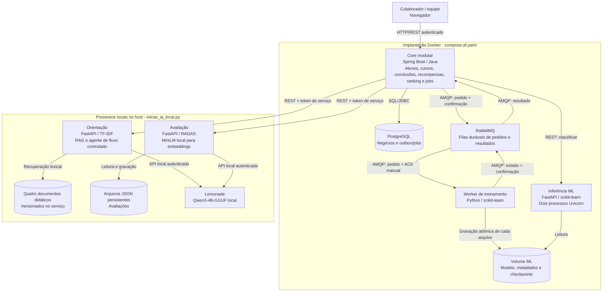

# C4 nível 2 - evolução da AC1

Cada aplicação abaixo tem seu próprio processo de execução. O Core reúne os módulos de negócio e serve a interface AF. A IA local roda no host Windows; o ambiente Docker foi validado no runner Linux da CI.

No protótipo, HTTP está limitado ao ambiente de demonstração. Para produção, a proposta exige TLS e identidade corporativa. O agente só consulta documentos após consentimento; não tem ferramenta de escrita no Core. O RAG não utiliza pgvector nem Spring AI nesta implementação. Artefatos e resultados locais ficam fora do Git, exceto cópias de evidência identificadas.

Na demonstração Windows sem Docker, H2 substitui PostgreSQL e a fila não é iniciada. Essa variante não é usada como comprovação de RabbitMQ: a evidência de interrupção e retomada vem da CI.
